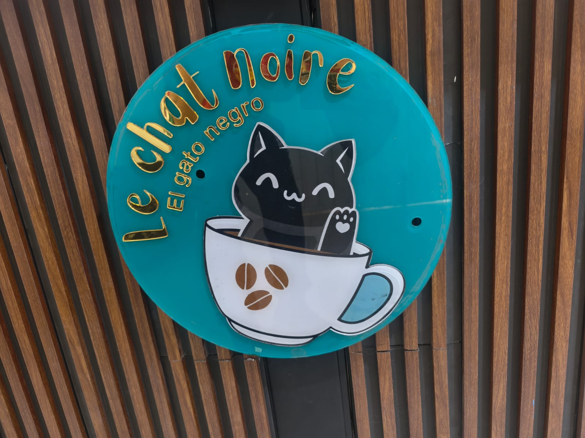
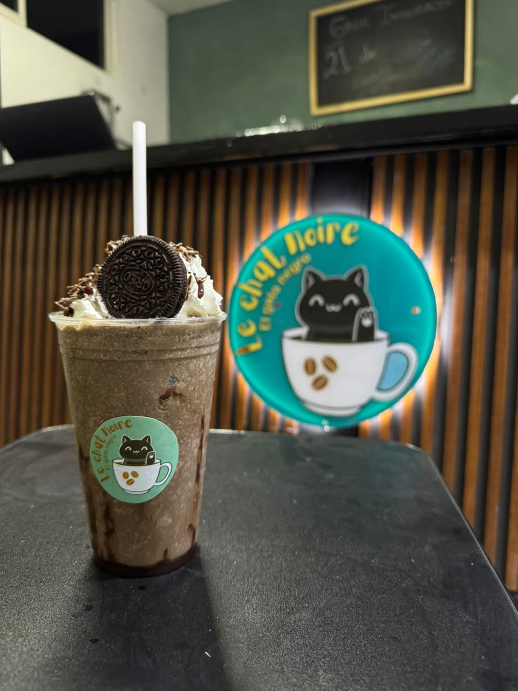
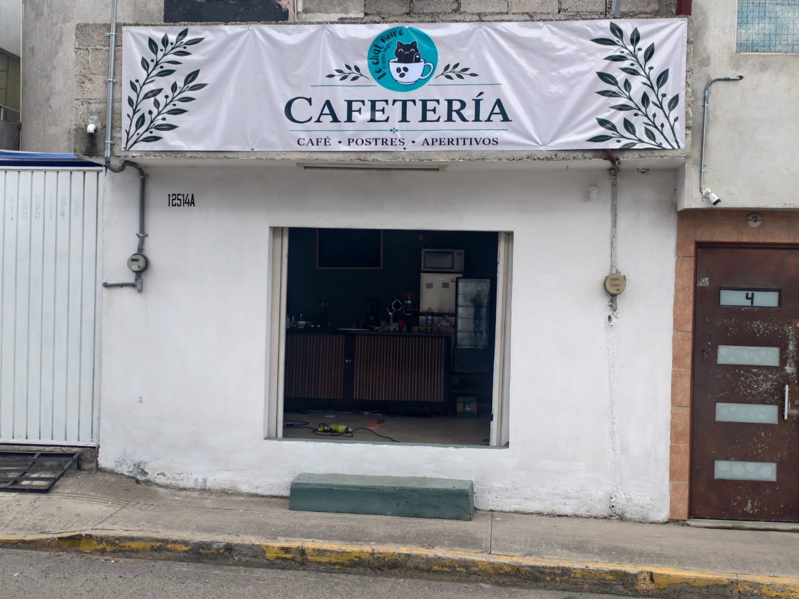

# Le Chat Noir · Sitio web de cafetería

Sitio web de **Le Chat Noir**, una cafetería en Puebla. Presenta la marca, permite explorar el menú por categorías y facilita el contacto para solicitar una reservación por WhatsApp.

Proyecto frontend desarrollado por [Diego Flores Díaz](https://github.com/Diego242004), con React, Vite y animaciones GSAP.



## Funcionalidades

- Página de una sola vista con secciones de inicio, historia, menú, galería, ubicación y contacto.
- Menú filtrable por Café, Fríos, Bebidas, Comida y Postres, con descripciones, precios y calorías estimadas cuando están disponibles.
- Galería con fotografías del negocio y video, controles anterior/siguiente y selección de contenido.
- Formulario que prepara un mensaje con nombre y consulta, y abre WhatsApp para que la persona lo envíe.
- Enlaces a ubicación en Google Maps, Instagram y TikTok.
- Diseño adaptable a móviles y escritorio, navegación móvil y mascota interactiva.
- Animaciones de entrada y desplazamiento con GSAP y ScrollTrigger; alternativa para la preferencia de movimiento reducido.
- Controles con etiquetas accesibles, estados ARIA y estilos de foco.

**Alcance actual:** es un frontend estático. El formulario no almacena datos ni confirma una reserva automáticamente; la confirmación se realiza por WhatsApp. No incluye backend, base de datos, pagos ni administración de productos.

## Tecnologías

| Tecnología | Uso |
| --- | --- |
| React y React DOM | Interfaz, estado de filtros, navegación y galería |
| Vite | Servidor de desarrollo y compilación de producción |
| GSAP, ScrollTrigger y @gsap/react | Animaciones y su integración con React |
| JavaScript (JSX), HTML y CSS | Componentes, estructura, estilos y diseño responsive |
| Google Fonts | Tipografías DM Sans, DM Mono y Playfair Display |

Las versiones reproducibles están registradas en `package-lock.json`; instala con `npm ci`.

## Ejecución local

### Requisitos

- Git.
- Node.js **22.12 o superior** (compatible con los requisitos de Vite fijados en el lockfile) y npm.
- Acceso a Internet para instalar dependencias. Las tipografías externas también requieren conexión.

```bash
git clone https://github.com/Diego242004/Le-Chat-Noir.git
cd Le-Chat-Noir
npm ci
npm run dev
```

Abre la URL que indique Vite en la terminal, normalmente `http://localhost:5173`. Si el puerto está ocupado, puede utilizar otro.

No se requieren claves de API ni archivo `.env` para la implementación actual.

### Comandos disponibles

| Comando | Resultado |
| --- | --- |
| `npm ci` | Instala las dependencias respetando el lockfile |
| `npm run dev` | Inicia el servidor de desarrollo |
| `npm run build` | Genera el sitio de producción en `dist/` |
| `npm run preview` | Sirve localmente la compilación para revisarla |

Para revisar la versión de producción:

```bash
npm run build
npm run preview
```

`preview` se utiliza para revisión local. Para publicar el sitio, sirve el contenido de `dist/` en un hosting estático. Las rutas actuales de imágenes y video parten de `/`: el proyecto está preparado para alojarse en la raíz del dominio; un despliegue en subcarpeta requiere adaptar esas rutas y la configuración de Vite.

## Estructura

| Ruta | Contenido |
| --- | --- |
| `index.html` | Idioma, título, metadatos y punto de entrada |
| `src/main.jsx` | Aplicación React, datos del menú, galería e interacciones |
| `src/styles.css` | Identidad visual, diseño responsive y movimiento reducido |
| `public/logo.png` | Logotipo utilizado en navegación y favicon |
| `public/gallery/` | Fotografías y video del negocio |
| `package.json` | Dependencias y comandos npm |
| `package-lock.json` | Versiones fijadas de las dependencias |

La rama principal del repositorio es `main`.

## Actualizar el contenido

Los datos están definidos dentro de `src/main.jsx`; actualmente no se cargan desde un JSON externo.

- **Productos:** edita el arreglo `menu`. Cada producto contiene `category`, `name`, `description`, `price`, `accent` y, opcionalmente, `calories`. Usa nombres únicos, ya que React los utiliza como claves.
- **Categorías:** mantén sincronizados el arreglo `categories` y el campo `category` de los productos. `Todo` muestra el menú completo.
- **Galería:** agrega archivos en `public/gallery/` y actualiza `galleryPhotos`. Las imágenes usan `src`, `alt` y `title`; el video usa `src`, `type: 'video'` y `title`.
- **Reservaciones:** actualiza el número en la URL `wa.me` dentro de `handleSubmit`. Debe incluir el código de país y solo dígitos.
- **Datos del negocio:** revisa horarios, dirección, enlace de Maps y redes sociales en las secciones correspondientes.
- **Estilos y metadatos:** modifica `src/styles.css` y `index.html`, respectivamente.

Revisa precios, disponibilidad y calorías antes de publicar cambios. El sitio presenta las calorías como estimaciones.

## Recursos visuales

Fotografías incluidas en el proyecto; **no son capturas de la interfaz**:

| Producto | Fachada |
| --- | --- |
|  |  |

El video del negocio está en [public/gallery/cafeteria.mp4](public/gallery/cafeteria.mp4).

## Presentación para portafolio

> Sitio web para Le Chat Noir, una cafetería en Puebla. Desarrollado con React y Vite, integra un menú filtrable, galería multimedia y solicitudes de reservación por WhatsApp. Incluye diseño responsive, animaciones con GSAP y ajustes para personas que prefieren movimiento reducido.

El código permite mostrar manejo de estado con hooks, renderizado de listas, formularios, integración con servicios mediante enlaces y diseño responsive con CSS.

### Verificación manual sugerida

1. Ejecutar `npm run build` y revisar el resultado con `npm run preview`.
2. Probar navegación y menú móvil, incluido el cierre con Escape.
3. Cambiar entre categorías y comprobar productos y precios.
4. Recorrer fotografías y reproducir el video.
5. Probar el formulario con datos de ejemplo: debe abrir WhatsApp con el mensaje preparado, sin necesidad de enviarlo.
6. Revisar enlaces de ubicación y redes, navegación por teclado y movimiento reducido.

Actualmente no hay scripts de pruebas automatizadas ni de lint en `package.json`.

## Autoría y uso de recursos

Desarrollo: [Diego Flores Díaz](https://github.com/Diego242004). La marca y los recursos del negocio se presentan como parte del proyecto Le Chat Noir.

Este repositorio no incluye un archivo de licencia. Antes de reutilizar o redistribuir código, fotografías, video o logotipos, consulta al titular correspondiente.
